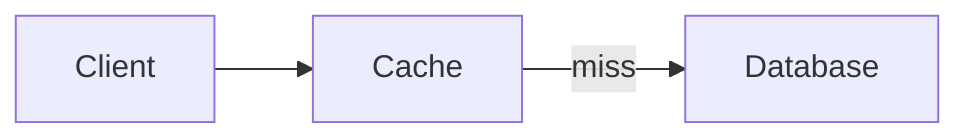

# Blog workspace

Open **Admin → Blogs**. **Write a post** creates a private draft. The editor saves
automatically and shows its save state. Failed saves retain your text; use **Retry
save** before navigating away. Concurrent edits from another window produce a
conflict instead of silently overwriting the newer version.

## Writing and preview

- Set the title, summary, and URL slug. Tags work like Books: press Enter to
  create a chip, select an existing suggestion, or remove a chip with ×.
  Tag changes save automatically.
- Switch between **Write**, **Split**, and **Preview**. **Preview article** opens
  a private, full-page preview of the saved draft using the public article layout.
- Use Markdown headings, lists, quotes, tables, links, and fenced code blocks.
  A code fence's language controls highlighting, for example `cpp`, `go`, `rust`,
  `javascript`, `typescript`, `python`, `sql`, `bash`, or `json`.
- Use a `mermaid` code fence to render diagrams. Invalid diagrams display an error
  beside their source. Mermaid is bundled locally and loads only when needed.
  Raw HTML and arbitrary scripts are not executed as article content.
- The icon toolbar formats the selected text or lines: H1/H2/H3, subtext,
  bold/italic, strikethrough, underline, bullets, numbered lists, todos, and quotes.
  Use `-# Small text` for subtext, `++underlined text++` for underline, and
  `- [ ]` / `- [x]` for tasks. Reader checkboxes display the saved task state.
  The **Code snippet**, **Mermaid diagram**, **Embed**, and **Link** buttons insert examples.
  Tab inserts two spaces in the Markdown editor; Ctrl/Cmd+S saves immediately.

An example diagram:

````markdown

````

## Screenshots and artwork

Use **Image**, paste a screenshot, or drop an image into the Markdown editor.
PNG, JPEG, WebP, and GIF uploads are supported, up to **12 MB / 24 megapixels**.
Animated GIFs use their first frame. Original uploads are retained; displayed
images are re-encoded as WebP with metadata removed, at up to 3000 pixels.
Thumbnail and avatar variants are generated and cached separately.

Choose alternative text, caption, width (10–100%), and alignment when inserting
an image. Click an image in the live preview to edit those settings. Drag its
right-hand resize handle, or focus the handle and use Left/Right to change width
by 5%. The image keeps its aspect ratio and fits narrow screens.

The Markdown sizing extension is:

```markdown
{width=65 align=center}
```

Images must be uploaded to the current post; arbitrary external image URLs are
shown as an upload prompt. **Artwork & images** holds the post's media library,
thumbnail uploads and image alignment, and ten animated technical
presets: **Contour atlas, Fluid currents, Gravity playground, Inside the
processor, Learning graph, Orbital mechanics, Reaction garden, Particle
accelerator, Light laboratory, and Signal paths**. A second collection reuses
the six original project animations: network, market, binary, stack, black hole,
and latency. Choose a preset or upload a custom thumbnail. Articles have no banner.
Thumbnails use 16:9 throughout the editor and reading lists. Gravity playground
simulates bouncing balls with gravity, wall impacts, and ball-to-ball collisions.

Animations use the shared project rendering code and animation clock, pause
offscreen or in hidden tabs, and respect reduced-motion preferences. On the
homepage they also follow the existing Motion control. Static SVG/JPEG fallbacks
remain available for loading, disabled JavaScript, and social previews.
The homepage and blog share `server/blog/theme.css` for page colors, fonts,
the Pixelware wordmark, header spacing, and the project-thumbnail gradient.
Animated blog canvases are transparent over that shared gradient.
Code blocks and Mermaid diagrams share the content colors and monospace font
from that stylesheet, along with matching containers, headings, and copy controls.

## Embedded content

An `embed` code fence accepts one HTTPS URL:

````markdown
```embed
https://codepen.io/your-name/pen/your-demo
```
````

Supported providers: YouTube, Vimeo, CodePen, CodeSandbox, StackBlitz, and the
Pixelware systems site (`systems.pixelware.nl`). Embeds run in sandboxed frames.
Other websites can be linked using normal Markdown links. Unsupported embed
URLs show a message instead of executing arbitrary markup.

## Publishing and history

**Publish** opens a confirmation without a revision-note field for first
publication. **Publish changes** offers an optional revision note for subsequent
updates. A title, summary, and article body are required. Publishing updates the
article and reading lists immediately; it does not require a frontend rebuild.

Editing a published article changes only its draft. Its previous live revision
stays public until **Publish changes** is used. **Unpublish** removes the article
and its images from public access while retaining its draft, uploads, and history.
The URL slug is fixed after first publication so shared links remain stable.

**History** records changed fields and publication notes. Autosaves from the same
editor session are grouped while saves are less than 15 minutes apart. Restoring
a snapshot updates the draft, preserving its published URL. It does not change
the live article until published again. History is visible only to the admin.

**Suggested posts** supports up to six selected articles in a manually ordered
list. An empty selection uses the four latest other published posts. Unpublished
suggestions are omitted. The article menu stays beside the text on desktop and
appears below it on mobile.

## Author and LinkedIn

**Author profile** sets the shared name, uploaded photo, and LinkedIn URL. Saving
this profile updates the byline across articles. An initial-letter avatar is used
until a photo is provided.

Automatic name/photo/identifier import is implemented through LinkedIn OpenID
Connect. It requires your own LinkedIn application and an actual account sign-in;
the app cannot retrieve private profile details from a pasted profile link.
The public profile URL remains an explicitly editable field. LinkedIn's `sub`
identifier is stored privately and is not treated as the public profile slug.

1. Enable **Sign In with LinkedIn using OpenID Connect** in the application's
   Products settings. See [LinkedIn's setup documentation](https://learn.microsoft.com/en-us/linkedin/consumer/integrations/self-serve/sign-in-with-linkedin-v2).
2. Register the exact callback URL:
   `https://pixelware.nl/api/public/blogs/linkedin/callback`.
3. On the VPS, create `/var/www/oo-portfolio/.deploy-secrets/blog.env`, readable
   only by the deployment administrator, containing:

   ```dotenv
   LINKEDIN_CLIENT_ID=your-client-id
   LINKEDIN_CLIENT_SECRET=your-client-secret
   ```

   The Compose configuration reads this optional file. The existing release
   installer links the persistent `.deploy-secrets` directory into each release,
   so the configuration survives deployments. Keep this file out of Git.
4. Recreate the admin container to load the values, then open **Author profile →
   Connect LinkedIn**. Only `openid profile` access is requested. No email scope
   or posting permissions are requested, and access tokens are not retained.

For standalone Compose, use the same `.deploy-secrets/blog.env` path in the
checkout. For `npm run dev`, put the variables in the ignored `.env.admin` file
and register the exact local callback origin if LinkedIn permits it. The Compose
optional `env_file` configuration requires Docker Compose 2.24 or later.

Without those credentials, the manual author controls work normally. The full
external sign-in/photo import still needs to be verified against your LinkedIn
application once configured.

## Public routes and storage

- `/blog`: public reading list, with five posts per page.
- `/blog/<slug>`: article HTML with navigation directly above the article,
  canonical URL, and sharing metadata.
- `/blog/share/<slug>.jpg`: a 1200×630 JPEG preview from the published thumbnail.
- `/api/public/blogs`: published summaries and cursor pagination.
- `/blog/sitemap.xml`: current published articles; referenced by `robots.txt`.
- Homepage: a **Blog** section after About me with larger artwork and compact
  bylines. It stays hidden when no articles are published. The first five posts
  appear initially; **Read more** appends the next five. The fade and button
  disappear when all articles are visible.

Posts, original uploads, WebP variants, revision snapshots, author settings, and
temporary OAuth state live in the existing `admin.sqlite` database and persistent
`admin_data` volume. Back up that database using the existing admin backup
procedure; blog media does not require an additional volume. No files from the
private book library are exposed through blog routes. Draft images are public
only when referenced by a currently published revision. Previously downloaded
public files cannot be recalled by unpublishing.

## Validation

`npm run dev` and `npm run build` generate the local Mermaid bundles;
`npm run build:blog` does this independently. The admin Docker image builds and
copies those bundles along with its required runtime packages. NGINX and Vite
proxy the blog routes to the existing admin service.

Run `npm run test:admin`, `npm run typecheck`, `npm run build`, and
`npm run test:static`. The blog integration tests cover draft privacy, authenticated
uploads, publication snapshots, conflicting writes, history/restore, persistence,
pagination, suggestion ordering, Markdown handling, and OAuth browser/session
correlation. The container smoke test also checks blog routing through NGINX.
